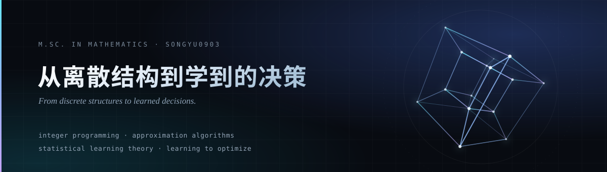

  

  
  
  

## 关于

数学专业硕士研究生，方向是**组合优化**与**机器学习**。一边做离散优化问题的建模、算法与复杂度，一边读统计学习理论与学习型优化。

> 比起单独追求预测精度，我更关心方法能给出什么可验证的保证：近似比、泛化界，或者决策损失的界。

## 研究方向

| 组合优化 | 统计学习理论 | 学习型优化 |
| :-- | :-- | :-- |
| 整数规划建模、近似算法、对偶与松弛 | 泛化界、稳定性、样本复杂度 | 用模型替代求解器里的决策环节 |

## 工具

  

## 在做

| 项目 | 说明 |
| :-- | :-- |
| [**songyu0903.github.io**](https://songyu0903.github.io) | 个人站 · 研究方向、论文笔记、推导记录（Hugo + KaTeX） |
| [**LogitechBatteryTray**](https://github.com/songyu0903/LogitechBatteryTray) | C# 托盘小程序 · 环形图标显示罗技鼠标电量 |

## 贡献

  <picture>
    <source media="(prefers-color-scheme: dark)" srcset="https://raw.githubusercontent.com/songyu0903/songyu0903/output/github-contribution-grid-snake-dark.svg" />
    <source media="(prefers-color-scheme: light)" srcset="https://raw.githubusercontent.com/songyu0903/songyu0903/output/github-contribution-grid-snake.svg" />
    
  </picture>

贡献贪吃蛇由 GitHub Actions 每日自动生成

